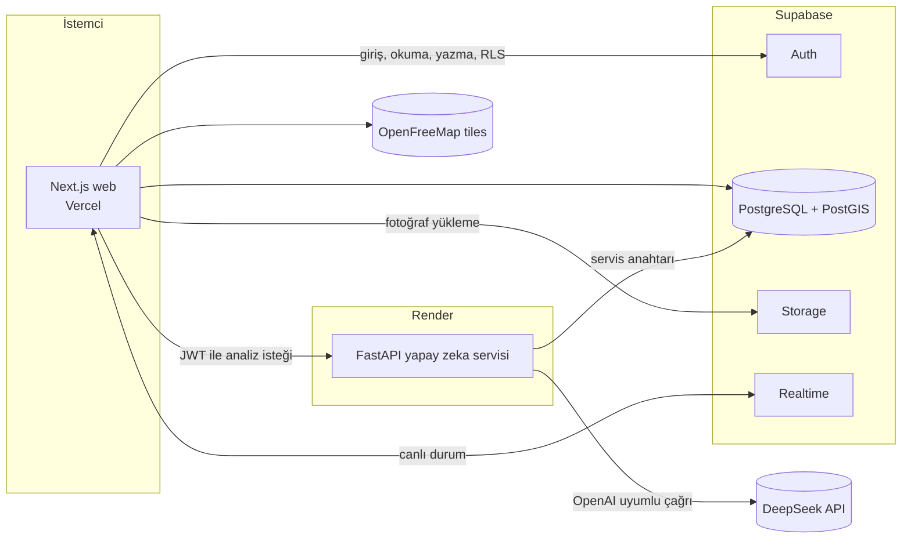

# Çözüm Kampüs: Proje Rehberi

> Yapay zeka destekli kampüs sorun bildirim ve takip platformu. Sakarya Üniversitesi bağlamında tasarlandı.
> Bu dosya fikir raporunu, ekran tasarımlarını ve teknoloji kararlarını tek yerde toplar. Repo kökünde `docs/PROJE_REHBERI.md` olarak durması önerilir.
> Son güncelleme: 27 Ekim 2026. Tarih içeren dış servis bilgileri o gün resmi dokümanlardan okundu, kullanmadan önce yeniden kontrol edin.

---

## 1. Özet

Kampüsteki her sorunu (bozuk lamba, su sızıntısı, kesilen Wi-Fi, arızalı asansör) öğrencinin saniyeler içinde bildirebildiği, yapay zekanın sınıflandırıp doğru birime yönlendirdiği ve sürecin herkese şeffaf göründüğü bir platform.

Üç kullanıcı grubu vardır ve yapay zeka bunları birbirine bağlar:

| Grup | Ne yapar |
|---|---|
| Öğrenci | Fotoğrafla ya da yazıyla/sesle bildirir, haritada ve zaman çizelgesinde takip eder, öneri paylaşır |
| Birim personeli | Günlük iş listesini rota sırasıyla görür, çözüm fotoğrafı yükler, malzeme talep eder |
| Yönetim | Genel durumu, ısı haritasını, birim performansını ve öğrenci önerilerini yönetir |

Vizyon: kampüs sorunlarını "bildirmesi zor, takibi imkânsız" olmaktan çıkarıp "10 saniyede bildirilen, canlı izlenen ve önceden tahmin edilen" hâle getirmek.

**Kapsam kararı:** Fikir raporundaki hiçbir özellik kapsamdan çıkarılmadı. Aşağıdaki öncelik sırası (P0, P1, P2) yalnızca geliştirme sırasını belirler.

---

## 2. Teknoloji kararları

| Katman | Seçim | Not |
|---|---|---|
| Web arayüzü | Next.js (App Router) + TypeScript + Tailwind CSS | Tasarımdaki sayfalar doğrudan route olur |
| Harita | MapLibre GL JS + OpenFreeMap | API anahtarı yok, ücretsiz, atıf MapLibre tarafından eklenir |
| Veritabanı, giriş, depolama, canlı güncelleme | Supabase (PostgreSQL + PostGIS) | Auth, Storage, Realtime, RLS hazır gelir |
| Yapay zeka servisi | FastAPI (Python) | Tüm model çağrıları sunucu tarafında |
| Yapay zeka modeli | DeepSeek API (OpenAI uyumlu) | Görüntü + metin, JSON çıktı. Sağlayıcı soyutlanır, ileride kendi modelimiz takılabilir |
| Web dağıtımı | Vercel | Hobby planı ticari olmayan kullanım içindir |
| API dağıtımı | Render (web service) | Ücretsiz katman, aşağıda uyarılar var |
| CI/CD | GitHub Actions | Lint, tip kontrolü, test, dağıtım tetikleri |
| İkonlar / yazı tipi | Phosphor / Geist + Geist Mono | Tasarımla aynı |

### 2.1 DeepSeek hakkında doğrulanan bilgiler (27 Ekim 2026, resmi dokümanlar)

- Taban adres: `https://api.deepseek.com` (OpenAI uyumlu). OpenAI SDK'sı `base_url` değiştirilerek kullanılır.
- Güncel model adı `deepseek-flash`. Eski adlar (`deepseek-v4-flash`, `deepseek-v4-flash-vision-exp`) hâlâ kabul ediliyor ama Flash modeline yönleniyor. **Model adını `.env` içinde tutun**, adlar değişiyor.
- `deepseek-flash` görüntü kabul eder: JPEG, PNG, GIF, WebP. Base64 (`data:` URL), herkese açık URL ya da Files API ile gönderilir. Görüntü yalnızca `user` mesajında olabilir (`system`/`assistant` içinde 400 hatası). İstek gövdesi sınırı 48 MiB, tek görsel 32 MiB, görsel başına en fazla 1024 token.
- JSON çıktı modu var: `response_format={"type":"json_object"}`, isteğin içinde "json" kelimesi ve örnek bir çıktı bulunmalı. Doküman bazen boş içerik döndürebildiğini söylüyor, bu yüzden **yeniden deneme + Pydantic doğrulaması** zorunlu.
- **Doğrulanamayan:** Görüntü girişi ile JSON modunun aynı istekte birlikte çalıştığı dokümanda yazmıyor. İlk iş bunu denemek. Çalışmazsa isteği JSON modu olmadan gönderip yanıtı ayıklayın (bkz. 7.3).
- **Doğrulanamayan:** Dokümanda ses girişi ve gömme (embedding) uç noktası görmedim. Sesli bildirim için tarayıcının konuşma tanıma özelliği (`SpeechRecognition`, `tr-TR`) başlangıçta yeterli; benzer bildirim bulmak için embedding yerine konum + kategori + model karşılaştırması kullanılır (bkz. 7.4).

### 2.2 KVKK ve yapay zeka sağlayıcısı

Karar: şimdilik DeepSeek API. Üniversite KVKK nedeniyle kendi modelimizi isterse en son ele alınacak. Buna hazırlanmak için:

- Model çağrıları tek bir `LLMProvider` arayüzünün arkasında olsun (bkz. 7.2). Sağlayıcı değişikliği tek dosya olsun.
- Modele kullanıcı kimliği, öğrenci numarası, ad, e-posta **gönderilmez**. Yalnızca bildirim metni, fotoğraf ve konum gider.
- Fotoğrafların EXIF verisi (GPS, cihaz bilgisi) yüklemeden önce silinir.
- Metindeki telefon, TC kimlik numarası ve e-posta gibi kişisel bilgiler gönderilmeden önce maskelenir.
- Anonim ve hassas (güvenlik kanalı) bildirimler modele **hiç gönderilmeden** işlenmesi seçeneği değerlendirilmeli (kural tabanlı yönlendirme).
- Verilerin yurt dışına aktarımı için hukuki değerlendirme üniversite/ekip tarafından yapılmalı. Bu dosya hukuki görüş değildir.

### 2.3 Ücretsiz katman sınırları (demo için kritik)

| Servis | Sınır | Etkisi |
|---|---|---|
| Render ücretsiz web servisi | 15 dk trafiksiz kalınca uyur, uyanması yaklaşık 1 dk. Ayda 750 saat. Dosya sistemi geçici. SSH yok | **Demodan 10 dk önce `/health` adresine istek atın**, gerekirse bir cron/uptime ping'i kurun. Kalıcı dosyayı Supabase Storage'a yazın |
| Supabase ücretsiz plan | 500 MB veritabanı, 1 GB depolama, 5 GB çıkış, 200 eşzamanlı Realtime bağlantısı, 1 hafta işlem olmazsa proje durur, en çok 2 aktif proje | Hackathon için yeterli. Demo öncesi projenin aktif olduğunu kontrol edin |
| Vercel Hobby | Ticari olmayan kullanım, 100 dağıtım/gün, fonksiyon süresi 300 sn | Hackathon için uygun. Canlıya ciddi şekilde çıkılırsa Pro gerekir |
| OpenFreeMap | Ücretsiz, anahtar yok, ama SLA yok | Demo günü internet gerekir, kaydedilmiş yedek video hazırlayın |

---

## 3. Mimari



Akış (öğrenci bildirimi):

1. Öğrenci `/bildir` sayfasında fotoğraf yükler. Dosya Supabase Storage'a gider (EXIF silinmiş).
2. Web, FastAPI'ye `POST /ai/analyze-report` çağırır: kategori, aciliyet, birim, özet, içerik denetimi sonucu döner. Sağ paneldeki "Yapay zeka analizi" bu yanıttan doldurulur.
3. FastAPI aynı çağrıda konum yakınındaki açık bildirimleri arar. Benzer bulursa "Bu sorun zaten bildirilmiş" kartı gösterilir.
4. Öğrenci gönderir. Web `reports` kaydını ve ilk `report_events` satırını oluşturur.
5. Atanan teknisyen, Realtime ile işini görür. Çözüm fotoğrafını yükleyince `POST /ai/verify-resolution` önce/sonra fotoğraflarını karşılaştırır.
6. Öğrenciye bildirim gider ve çözüm onayı istenir. Onay gelirse kayıt kapanır, gelmezse yeniden açılır.

---

## 4. Rolller ve yetkiler

| Rol | Kimdir | Nereye erişir |
|---|---|---|
| `student` | Okul e-postasıyla giriş yapan öğrenci | `/` (harita), `/bildirimlerim`, `/oneriler`, `/bildir`, `/bildirimler`, `/hesap` |
| `staff` | Bir birime bağlı teknisyen | `/personel/*` |
| `admin` | Yönetim | `/yonetim/*` |
| `security` | Güvenlik birimi | Güvenlik kanalındaki bildirimler |

Giriş yöntemi henüz tasarlanmadı. Öneri: Supabase Auth ile okul e-posta alan adı kısıtlı e-posta bağlantısı/OTP. Üniversite tek oturum açma (SSO) sonraya bırakıldı. `staff`, `admin` ve `security` rolleri `profiles.role` alanına elle atanır.

---

## 5. Ekran envanteri ve route eşlemesi

Tasarım dosyaları tasarım tuvalinde (`Çözüm Kampüs: Ekran Tasarımları`) 1440 px genişlikte. Her satır bir sayfadır.

### Öğrenci

| Ekran | Route | İçerik |
|---|---|---|
| Harita | `/` | MapLibre harita, bina işaretleri, sol panelde bina/bildirim listesi, sağ panelde seçili bildirim detayı ve zaman çizelgesi, "Ben de yaşıyorum", Acil durum butonu |
| Bildirimlerim | `/bildirimlerim` | Açtıklarım/Desteklediklerim sekmeleri, durum filtreleri, detay: durum geçmişi, önce/sonra, haber ver anahtarı, ek fotoğraf, geri çekme |
| Öneriler | `/oneriler` | Oylanabilir öneri listesi, yönetim yanıtları, öneri yazma formu (benzer öneri uyarısı, adı gizleme), kampüs karnesi |
| Bildir | `/bildir` | Fotoğraf/Yazı/Ses sekmeleri, fotoğraflar, açıklama (sesle anlat), konum, anonim anahtarı, yapay zeka analizi, benzer bildirim uyarısı, hassas konu kanalı, Acil durum |
| Bildirimler (merkez) | `/bildirimler` | Bugün/Dün/Daha eski bildirimler, çözüm onayı ("Evet, çözüldü" / "Hâlâ sorun var"), tercihler |
| Hesabım | `/hesap` | Profil bilgileri, çıkış, hesabı ve verileri silme |

### Birim personeli

| Ekran | Route | İçerik |
|---|---|---|
| İşler | `/personel` | Günün rota sırası, tamamlananlar, iş detayı, iş adımları, çözüm fotoğrafı ve yapay zeka doğrulaması, "Rota" butonu, devretme |
| Geçmiş | `/personel/gecmis` | Tamamlanan işler tablosu, doğrulama ve öğrenci onayı, seçili işin önce/sonra detayı |
| Malzeme | `/personel/malzeme` | Depo stoğu, günlük yapay zeka malzeme tahmini, talepler |

Üst menüde yalnızca bu üç sekme var.

### Yönetim

| Ekran | Route | İçerik |
|---|---|---|
| Genel bakış | `/yonetim` | Hassas bildirim uyarısı, KPI'lar, ısı haritası, haftalık yapay zeka özeti, birim performansı |
| Bildirimler | `/yonetim/bildirimler` | Tüm kayıtlar, filtreler, yönlendirme, birleştirme, iç not |
| Birimler | `/yonetim/birimler` | Birim kartları, ekip durumu, iş atama |
| Kampüs sesi | `/yonetim/kampus-sesi` | Öneri listesi, durum ve herkese açık yanıt yazma, yapay zeka taslağı |

### Tasarım sürecinde verilen kararlar (uygulamada geçerli)

- Puan ve rozet sistemi arayüzden çıkarıldı. Ürün kapsamında kalıp kalmayacağı sonra netleşecek.
- "Taslağı kaydet" yok. QR kod sekmesi yok: QR kodlar mekânlara yapıştırılır ve doğrudan `/bildir?yer=<qr_kodu>` adresini açar, konum otomatik dolar.
- Hesabım yalnızca profil bilgileri ve hesap silme içerir. Erişilebilirlik ve gizlilik ayarları bu sayfadan çıkarıldı.
- Personel arayüzünde harita sekmesi, zil ve profil simgesi yok. Rota için iş detayındaki "Rota" butonu kullanılır.
- Yönetim Genel bakış'ında Kampüs sesi kartı yok, ayrı sekmede.
- Mobil uyarlama web bittikten sonra yapılacak. Eski mobil taslaklar tuvalin altında duruyor ve geçersiz sayılmalı.
- **Ertelenenler:** İçerik denetimi "reddedildi" durumunun arayüzü, yönetimdeki "İncelenecek içerik" kuyruğu, boş/yükleniyor/hata durumları, giriş ekranı, onay pencereleri.

---

## 6. Tasarım sistemi

Cam (saydam) paneller, lacivert-mavi-beyaz palet. Tüm renkler tasarımda sabit.

| Token | Değer | Kullanım |
|---|---|---|
| `ink` | `#0F2A5C` | Metin, ana buton |
| `ink-hover` | `#1B3F85` | Ana buton hover |
| `accent` | `#1F5FD6` | Odak halkası, bağlantı, vurgu |
| `muted` | `#566486` | İkincil metin |
| `tint` | `#E8EFFA` / `#EEF3FB` | Seçili/hover arka plan |
| `hairline` | `#DCE4F0` | Ayırıcı çizgi |
| `input-border` | `#CBD5E5` | Form alanı çerçevesi |
| `map-bg` | `#E9EEF5` | Sayfa/harita zemini |
| `danger` | `#B91C1C` (hover `#991B1B`) | Acil, kritik |
| Durum: işlemde | `#FEF3C7` / `#92400E` | |
| Durum: çözüldü | `#DCFCE7` / `#166534` | |
| Durum: alındı | `#E5E7EB` / `#374151` | |

Cam panel: `background: rgba(255,255,255,0.72); backdrop-filter: blur(24px) saturate(160%); border: 1px solid rgba(15,42,92,0.12); box-shadow: 0 8px 32px rgba(15,42,92,0.14); border-radius: 16px`. İç öğelerde yarıçap 8 px.

Kurallar: yazı tipi Geist (400/500/600), sayılar ve saatler Geist Mono. İtalik yok. Başlıklarda tek tip aralık ölçeği (4/8/12/16/24/32). Animasyon yalnızca `transform` ve `opacity`, `prefers-reduced-motion` desteklenir. Her etkileşimli öğede hover, `active:scale-[0.98]` ve görünür odak halkası bulunur. Metinde tire kullanılmaz, sistem mesajları sakin tonda yazılır. Üniversitenin resmi logosu ve markası **kullanılmaz**; kendi Çözüm Kampüs logomuz kullanılacak (logo henüz yok, yer tutucu var).

Tailwind `theme.extend.colors` altına yukarıdaki token'lar eklenmeli. Tasarım dosyalarında satır içi stil olarak duran değerler bileşenlere dönüştürülürken bu token'lara bağlanmalı.

---

## 7. Yapay zeka katmanı

### 7.1 Görevler

| Görev | Girdi | Çıktı | Öncelik |
|---|---|---|---|
| Bildirim analizi | Fotoğraf + metin + konum | Kategori, aciliyet, birim, başlık, özet, malzeme tahmini, hassas mı, içerik denetimi | P0 |
| Çözüm doğrulama | Önce + sonra fotoğrafı | Çözüldü mü, güven oranı, not | P0 |
| Benzer bildirim bulma | Yeni bildirim + yakındaki açık bildirimler | Aynı sorun mu, hangi kayıt | P1 |
| Öneri yanıt taslağı | Öneri metni, destek sayısı | Herkese açık yanıt taslağı | P1 |
| Haftalık özet | Haftalık toplu istatistikler | 4 maddelik içgörü | P1 |
| Sesli bildirim | Konuşma (tarayıcıda metne çevrilir) | Metin bildirimiyle aynı | P1 |
| Çok dilli bildirim | Herhangi dilde metin | Türkçe çeviri + analiz | P2 |
| Kampüs asistanı | Soru + bildirim kayıtları | Kayıtlara dayalı cevap | P2 |
| Tahmine dayalı bakım, mevsimsel uyarı | Geçmiş arıza verisi, hava tahmini | Uyarı | P2 |
| Erişilebilir rota | Arızalı noktalar + bina grafiği | Alternatif rota | P2 |

### 7.2 Sağlayıcı soyutlaması

```python
# services/ai/app/llm/base.py
from typing import Protocol

class LLMProvider(Protocol):
    async def complete_json(self, *, system: str, user_text: str,
                            image_b64: list[str] | None = None,
                            schema_hint: str) -> dict: ...
```

```python
# services/ai/app/llm/deepseek.py
import os, json
from openai import AsyncOpenAI

client = AsyncOpenAI(api_key=os.environ["DEEPSEEK_API_KEY"],
                     base_url=os.getenv("DEEPSEEK_BASE_URL", "https://api.deepseek.com"))
MODEL = os.getenv("LLM_MODEL", "deepseek-flash")

async def complete_json(system, user_text, image_b64=None, schema_hint=""):
    content = [{"type": "text", "text": user_text + "\n\nYanıtı yalnızca geçerli JSON olarak ver. Örnek biçim:\n" + schema_hint}]
    for b in image_b64 or []:
        content.append({"type": "image_url", "image_url": {"url": f"data:image/jpeg;base64,{b}"}})
    for _ in range(3):  # boş yanıt ve geçersiz JSON için yeniden dene
        r = await client.chat.completions.create(
            model=MODEL, max_tokens=800,
            messages=[{"role": "system", "content": system}, {"role": "user", "content": content}],
            response_format={"type": "json_object"})  # görsel ile birlikte çalışmazsa kaldırın
        txt = (r.choices[0].message.content or "").strip()
        if txt:
            try:
                return json.loads(txt)
            except json.JSONDecodeError:
                continue
    raise RuntimeError("Model geçerli JSON döndürmedi")
```

Sonrasında yanıt Pydantic modeliyle doğrulanır; doğrulanamazsa kural tabanlı varsayılana düşülür (bildirim kaydı yine açılır, "Yapay zeka analizi bekleniyor" olarak işaretlenir). Model yanıt vermese bile sistem çalışmalı.

### 7.3 Bildirim analizi: çıktı şeması

```json
{
  "title": "Koridor lambası yanmıyor",
  "category": "aydinlatma",
  "urgency": "orta",
  "unit": "yapi_isleri",
  "summary": "Tavandaki floresan armatür yanmıyor, koridor akşam karanlık kalıyor.",
  "materials": ["LED tüp 18 W", "starter"],
  "is_sensitive": false,
  "moderation": { "ok": true, "reasons": [] },
  "confidence": 0.94
}
```

Kategoriler: `aydinlatma, su_tesisat, asansor_erisilebilirlik, internet_ag, temizlik, mobilya, isitma_sogutma, guvenlik, diger`. Aciliyet: `dusuk, orta, acil`. Sistem komutu şunları açıkça söylemeli: Çıktı yalnızca JSON; hakaret/küfür ve kişi odaklı (yüz, çıplaklık, şiddet) görüntüler `moderation.ok=false`; fotoğraf kampüs sorunuyla ilgili değilse `moderation.reasons` içinde belirtilir; taciz, şiddet, intihar riski gibi sinyaller `is_sensitive=true` yapar. Aciliyet tanımı: elektrik, yangın, yaralanma, mahsur kalma riski `acil`.

### 7.4 Benzer bildirim bulma (embedding gerektirmez)

1. PostGIS ile aynı binada/50 m içinde, açık ve aynı kategorideki en çok 5 bildirim çekilir (`ST_DWithin`).
2. Model, yeni bildirim ile bu 5 adayı karşılaştırıp "aynı sorun" olanı ve güven oranını döner.
3. Güven yüksekse "Bu sorun zaten bildirilmiş" kartı çıkar; öğrenci "Ben de yaşıyorum" ya da "Yine de yeni bildirim aç" der. Gönderilen yeni kayıt `parent_report_id` ile birleştirilir ve `vote_count` artar.

İleride embedding gerekirse `pgvector` ve FastAPI içinde çok dilli küçük bir model kullanılabilir.

### 7.5 İçerik denetimi (küfür ve hassas fotoğraf)

Katmanlı çalışır; öneriler ve bildirimler aynı hattı kullanır.

1. **Gönderim öncesi (sunucuda):** Metin için kural + model, fotoğraf için model kontrolü. Aynı analiz çağrısının içinde yapılır.
2. **Sonuç:** Temizse yayınlanır. Kesin uygunsuzsa gönderilmez ve kullanıcıya sakin bir mesaj gösterilir. Emin değilse kayıt alınır ama herkese açık alanda gizlenir, yönetim "İncelenecek içerik" kuyruğuna düşer.
3. **Yayından sonra:** Kullanıcı "Uygunsuz içerik bildir" ile işaretleyebilir. Belirli sayıda işaret içeriği otomatik gizler (`moderation_flags`).
4. **Yinelenen ihlal:** Hesap uyarılır/kısıtlanır. Anonim bildirimde bile oturum bilgisi arka planda tutulur; anonimlik yalnızca birimlere karşı geçerlidir.
5. **Gizlilik:** Fotoğraflardaki yüz ve plaka bulanıklaştırması (OpenCV) P2 olarak değerlendirilir.

---

## 8. Veri modeli (Supabase / PostgreSQL)

Taslak şema. `supabase/migrations/0001_init.sql` olarak başlangıç alınabilir.

```sql
create extension if not exists postgis;

create type user_role as enum ('student','staff','admin','security');
create type report_status as enum ('alindi','yonlendirildi','atandi','islemde','cozuldu','yeniden_acildi','geri_cekildi');
create type urgency as enum ('dusuk','orta','acil');
create type suggestion_status as enum ('yeni','degerlendiriliyor','planlandi','uygulandi','reddedildi');
create type media_kind as enum ('once','sonra','ek');

create table profiles (
  id uuid primary key references auth.users on delete cascade,
  full_name text, student_no text, department text,
  role user_role not null default 'student',
  unit_id bigint,                      -- staff için
  language text default 'tr',
  created_at timestamptz default now()
);

create table units (id bigint generated always as identity primary key, name text not null, slug text unique not null);

create table buildings (
  id bigint generated always as identity primary key,
  name text not null, floors int, location geography(point, 4326) not null
);

create table places (                  -- QR kodların bağlandığı mekanlar
  id bigint generated always as identity primary key,
  building_id bigint references buildings, floor int, name text,
  qr_code text unique not null, location geography(point, 4326)
);

create table reports (
  id bigint generated always as identity primary key,
  reporter_id uuid references profiles,
  is_anonymous boolean default false,
  title text not null, description text,
  category text, urgency urgency default 'orta', status report_status default 'alindi',
  unit_id bigint references units, building_id bigint references buildings,
  place_id bigint references places, floor int,
  location geography(point, 4326),
  ai_summary text, ai_confidence real, ai_materials text[],
  parent_report_id bigint references reports,
  vote_count int default 1, is_hidden boolean default false,
  created_at timestamptz default now(), resolved_at timestamptz
);
create index on reports using gist (location);
create index on reports (status, unit_id);

create table report_media (
  id bigint generated always as identity primary key,
  report_id bigint references reports on delete cascade,
  kind media_kind not null, storage_path text not null,
  ai_verified boolean, ai_confidence real, created_at timestamptz default now()
);

create table report_events (           -- zaman çizelgesi
  id bigint generated always as identity primary key,
  report_id bigint references reports on delete cascade,
  type text not null, actor_id uuid, payload jsonb, created_at timestamptz default now()
);

create table report_votes (report_id bigint references reports on delete cascade, user_id uuid references profiles, primary key (report_id, user_id));

create table assignments (
  report_id bigint references reports on delete cascade, staff_id uuid references profiles,
  assigned_at timestamptz default now(), started_at timestamptz, completed_at timestamptz,
  route_order int, primary key (report_id, staff_id)
);

create table suggestions (
  id bigint generated always as identity primary key,
  author_id uuid references profiles, is_anonymous boolean default false,
  category text, title text not null, body text,
  status suggestion_status default 'yeni', vote_count int default 0,
  merged_into bigint references suggestions, is_hidden boolean default false,
  created_at timestamptz default now()
);
create table suggestion_votes (suggestion_id bigint references suggestions on delete cascade, user_id uuid references profiles, primary key (suggestion_id, user_id));
create table suggestion_replies (
  id bigint generated always as identity primary key,
  suggestion_id bigint references suggestions on delete cascade,
  admin_id uuid references profiles, body text not null,
  status_set suggestion_status, created_at timestamptz default now()
);

create table notifications (
  id bigint generated always as identity primary key,
  user_id uuid references profiles, type text, title text, body text,
  payload jsonb, read_at timestamptz, created_at timestamptz default now()
);
create table notification_prefs (user_id uuid primary key references profiles, channels jsonb, types jsonb, quiet_hours int4range);

create table inventory (id bigint generated always as identity primary key, unit_id bigint references units, name text, qty int, min_qty int);
create table material_requests (id bigint generated always as identity primary key, requester_id uuid references profiles, item_id bigint references inventory, qty int, status text default 'onay_bekliyor', created_at timestamptz default now());

create table security_reports (        -- anonim güvenlik kanalı, ayrı tablo
  id bigint generated always as identity primary key,
  body text not null, location geography(point, 4326),
  status text default 'yeni', created_at timestamptz default now()
);

create table moderation_flags (
  id bigint generated always as identity primary key,
  target_type text, target_id bigint, reason text,
  source text check (source in ('ai','user')), status text default 'acik',
  created_at timestamptz default now()
);

create table ai_runs (                 -- kayıt ve önbellek
  id bigint generated always as identity primary key,
  kind text, model text, input_hash text, output jsonb, latency_ms int, created_at timestamptz default now()
);
```

Satır güvenliği (RLS) ilkeleri:

- Öğrenci yalnızca kendi bildirimlerini yazar/düzenler; herkese açık bildirimleri `is_hidden = false` ise okur.
- Anonim bildirimlerde `reporter_id` saklanır ama öğrenci/personel/yönetim sorgularında görünmesin: ham tabloya doğrudan erişim yerine `public_reports` görünümü kullanın.
- `staff` yalnızca kendi birimine yönlendirilmiş bildirimleri görür ve günceller. `admin` hepsini görür.
- `security_reports` yalnızca `security` rolü okuyabilir. Öğrenci yazar ama geri okuyamaz.
- Medya yolları Storage politikalarıyla korunur; "önce/sonra" fotoğrafları yalnızca ilgili kişilere ve kayıt herkese açıksa tüm öğrencilere görünür.
- Realtime: `reports`, `report_events`, `notifications` tablolarında etkinleştirin (filtre `user_id`/`id` ile).

---

## 9. FastAPI servisi

| Uç nokta | Açıklama | Öncelik |
|---|---|---|
| `GET /health` | Uyandırma ve izleme | P0 |
| `POST /ai/analyze-report` | Metin + görsel URL'leri + konum → analiz + benzer aday | P0 |
| `POST /ai/verify-resolution` | Önce/sonra fotoğrafı → çözüldü mü | P0 |
| `POST /ai/suggest-reply` | Öneri için yanıt taslağı | P1 |
| `POST /ai/weekly-summary` | Haftalık içgörüler (zamanlanmış çağrı) | P1 |
| `POST /ai/chat` | Kampüs asistanı | P2 |

Doğrulama: web, Supabase oturum JWT'sini `Authorization: Bearer` ile gönderir; FastAPI JWT'yi Supabase JWT sırrıyla doğrular. Veritabanına yazma için servis anahtarı yalnızca FastAPI'de durur, tarayıcıya asla gönderilmez. CORS yalnızca Vercel alan adına açılır. Hız sınırı (kullanıcı başına dakikada N istek) ve görsel boyut sınırı ekleyin; aksi hâlde API anahtarınız tüketilir.

---

## 10. Depo yapısı

```
cozum-kampus/
├─ apps/
│  └─ web/                      # Next.js (App Router, TypeScript, Tailwind)
│     ├─ app/
│     │  ├─ (ogrenci)/          # /, /bildirimlerim, /oneriler, /bildir, /bildirimler, /hesap
│     │  ├─ personel/           # /personel, /gecmis, /malzeme
│     │  ├─ yonetim/            # /yonetim, /bildirimler, /birimler, /kampus-sesi
│     │  └─ giris/
│     ├─ components/            # ui/ (Glass, Button, Pill, Switch ...), map/, report/
│     ├─ lib/                   # supabase client, ai client, utils
│     └─ tailwind.config.ts     # 6. bölümdeki token'lar
├─ services/
│  └─ ai/                       # FastAPI
│     ├─ app/{main.py,routers/,llm/,schemas/,prompts/}
│     ├─ tests/
│     ├─ requirements.txt
│     └─ Dockerfile
├─ supabase/
│  ├─ migrations/               # 0001_init.sql ...
│  ├─ seed.sql                  # demo verisi (bina, birim, örnek bildirimler)
│  └─ config.toml
├─ docs/
│  ├─ PROJE_REHBERI.md          # bu dosya
│  └─ tasarim/                  # tuvalden dışa aktarılan ekran görüntüleri
├─ .github/workflows/{web.yml,ai.yml}
├─ render.yaml                  # Render blueprint
├─ .env.example
└─ README.md
```

Ortam değişkenleri (`.env.example`):

```
# web (Vercel)
NEXT_PUBLIC_SUPABASE_URL=
NEXT_PUBLIC_SUPABASE_ANON_KEY=
NEXT_PUBLIC_AI_API_URL=https://<render-servisi>.onrender.com

# ai (Render) - bunlar tarayıcıya asla gitmemeli
SUPABASE_URL=
SUPABASE_SERVICE_ROLE_KEY=
SUPABASE_JWT_SECRET=
DEEPSEEK_API_KEY=
DEEPSEEK_BASE_URL=https://api.deepseek.com
LLM_MODEL=deepseek-flash
ALLOWED_ORIGIN=https://<vercel-alan-adi>.vercel.app
```

---

## 11. CI/CD

- **web.yml:** `pnpm install` → `lint` → `tsc --noEmit` → `build`. Dağıtım Vercel'in GitHub entegrasyonuyla (her PR için önizleme).
- **ai.yml:** `ruff` + `pytest` → Render dağıtımı (Render GitHub'dan otomatik dağıtır ya da deploy hook ile tetiklenir).
- Veritabanı: `supabase db push` yerel `supabase start` ile denenmiş migration'larla.
- Gizli anahtarlar GitHub Secrets / Vercel / Render panelinde. Depoya anahtar işlemeyin; `.env` `.gitignore` içinde olsun.
- İzleme (DevOps vitrini): `/health`, yapay zeka çağrılarının gecikme/hata oranı `ai_runs` tablosundan, basit bir durum sayfası.

---

## 12. Öncelik ve 24 saatlik plan

Kapsam daraltılmadı, yalnızca sıra belirlendi. Şu an tek geliştirici var, ekip sonra katılacak.

**P0: Demo omurgası**
1. Supabase kurulumu, şema, seed, giriş (okul e-postası)
2. `/bildir`: fotoğraf yükleme → `analyze-report` → kayıt
3. `/` Harita: MapLibre işaretleri, bina listesi, bildirim detayı + zaman çizelgesi
4. `/bildirimlerim`: liste, detay, Realtime durum
5. `/personel`: iş listesi, çözüm fotoğrafı, `verify-resolution`
6. `/yonetim`: KPI + ısı haritası (şimdilik `reports` toplulaştırması)

**P1**
Benzer bildirim ve "Ben de yaşıyorum", `/oneriler` ve `/yonetim/kampus-sesi`, bildirim merkezi, çözüm onayı, anonim bildirim, Acil durum butonu ve hassas kanal, `/yonetim/bildirimler`, `/yonetim/birimler`, haftalık özet, sesli bildirim, personel geçmiş/malzeme.

**P2**
Kampüs asistanı, çok dilli destek, tahmine dayalı bakım ve mevsimsel uyarılar, erişilebilir rota, içerik denetimi kuyruğu, yüz/plaka bulanıklaştırma, mobil uyarlama, ağ izleme.

**Önerilen zaman çizelgesi (tek kişi)**

| Saat | İş |
|---|---|
| 0 – 2 | Repo, Supabase, şema, seed, Next.js iskeleti, Tailwind token'ları, ortak bileşenler |
| 2 – 5 | Giriş, `/bildir` + FastAPI analiz hattı (demo bunun etrafında döner) |
| 5 – 9 | Harita + bildirim detayı + zaman çizelgesi, `/bildirimlerim` |
| 9 – 13 | Personel akışı + çözüm doğrulama, bildirim üretimi (olaylar) |
| 13 – 17 | Yönetim paneli, ısı haritası, haftalık özet |
| 17 – 21 | P1 maddeleri (benzer bildirim, öneriler, bildirim merkezi) |
| 21 – 24 | Demo verisi, provalar, yedek video, Render'ı uyandırma, sunum |

Ekip katıldığında bölme önerisi: biri arayüz (öğrenci), biri arayüz (personel + yönetim), biri yapay zeka servisi ve veri, sen entegrasyon ve DevOps.

---

## 13. Demo günü riskleri

| Risk | Önlem |
|---|---|
| Render servisi uykuda | Sunumdan 10 dk önce `/health` isteği, mümkünse düzenli ping |
| DeepSeek yavaş/erişilemez | Önceden hazırlanmış örnek analizler (ör. `ai_runs` önbelleği) ile yedek yol, zaman aşımı kısa tutulur |
| Harita karoları yüklenmiyor | Kaydedilmiş ekran videosu, çevrimdışı yedek sunum |
| Canlı internet / Wi-Fi | Mobil hotspot yedeği |
| Supabase projesi durmuş | Sunumdan önce giriş yapıp kontrol |
| Gerçek veri yok | `seed.sql` ile gerçekçi demo verisi (bina adları gerçek, bildirimler kurgusal) |

---

## 14. Açık işler

- [ ] Çözüm Kampüs logosu (şu an yer tutucu)
- [ ] Giriş ve kayıt ekranı tasarımı
- [ ] İçerik denetimi "reddedildi" arayüzü ve yönetimde "İncelenecek içerik" kuyruğu
- [ ] Boş, yükleniyor, hata durumları; onay pencereleri
- [ ] Puan/rozet kararı (arayüzden çıkarıldı)
- [ ] Sakarya Üniversitesi bina koordinatları ve QR kod envanteri (gerçek veri)
- [ ] Görüntü + JSON modu birlikte çalışıyor mu denemesi (bkz. 2.1)
- [ ] KVKK hukuki değerlendirmesi ve gerekirse kendi model planı
- [ ] Mobil uyarlama (web sonrası)
- [ ] Ek fikirler (kapsam dışı, sonra değerlendirilecek): ağ izleme (Wi-Fi şikâyeti birikince erişim noktası kontrolü), IoT sensörleri (su sızıntısı vb.), üniversite SSO

---

## 15. VS Code'da başlangıç komutları

```bash
mkdir cozum-kampus && cd cozum-kampus && git init
mkdir -p apps services docs supabase

# Web
npx create-next-app@latest apps/web --typescript --tailwind --eslint --app --src-dir=false --import-alias "@/*"
cd apps/web && npm i @supabase/supabase-js @supabase/ssr maplibre-gl @phosphor-icons/react && cd ../..

# Supabase (yerel geliştirme için Docker gerekir)
npx supabase init
npx supabase start

# Yapay zeka servisi
mkdir -p services/ai/app && cd services/ai
python -m venv .venv && source .venv/bin/activate   # Windows: .venv\Scripts\activate
pip install fastapi "uvicorn[standard]" openai pydantic python-jose httpx pytest ruff
pip freeze > requirements.txt
uvicorn app.main:app --reload --port 8000
```

Harita stilleri: `https://tiles.openfreemap.org/styles/liberty` (ya da `bright`, `positron`). MapLibre atıf metnini otomatik ekler; kaldırmayın.

İlk kontrol listesi: (1) DeepSeek anahtarıyla görsel + JSON denemesi, (2) Supabase'de tablo ve RLS, (3) Next.js'ten Supabase girişi, (4) `/bildir` sayfası → FastAPI → yanıt, (5) Render'a ilk dağıtım. Bu beş adım çalışınca geri kalan her şey bunların üstüne kurulur.
